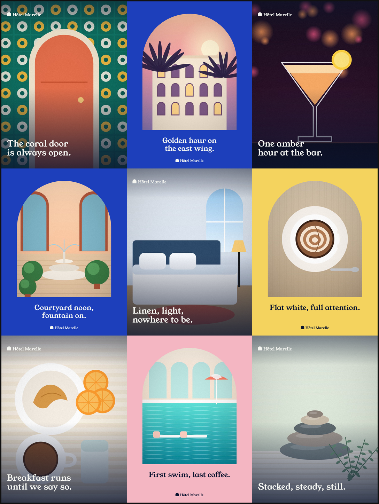

# Noomoo Studio

**Brand guide + images in, a complete Instagram kit out.** A small, repeatable pipeline that curates a nine-post grid, generates three 9:16 stories with live editable typography, lets a user swap any image, and exports PNGs plus layered SVG sources.

Submission for the Noomoo AI Lab *Generative AI & Creative Engineer* technical assessment, by Imeobong Monday.

**[Watch the 3-minute demo](https://youtu.be/qarqPwgIUq4)** · [Quick start](#quick-start) · [How it works](#how-it-works) · [Optional AI layer](#optional-ai-layer)



Two fictional brands ship in the box (**Hôtel Marelle** and **Tidehouse**) to show one codebase serving different identities.

## At a glance

| | |
|---|---|
| Output | 9 posts (1080×1350), 3 stories (1080×1920), 12 layered SVG sources, HTML preview, manifest, zip |
| Repeatability | Deterministic: two builds give byte-identical files (tested) |
| Stack | Python 3.10+, Flask, Jinja2, Pillow, NumPy, resvg |
| Tests | 55 passing |
| Setup | No browser, no system libraries, no API keys required |

## Quick start

Requires Python 3.10+. No browser, no system libraries, no API keys.

```bash
python -m venv .venv
.venv\Scripts\activate          # Windows PowerShell / cmd
# source .venv/bin/activate     # macOS / Linux
pip install -r requirements.txt

python -m studio build          # builds every brand into dist/  (about 15 s per brand)
python -m studio serve          # web UI at http://127.0.0.1:5000
python -m pytest -q             # 55 tests (1 to 2 minutes: the export tests render about 25 images)
```

In VS Code: open the folder, pick the `.venv` interpreter, then use **Run and Debug** ("Studio: web UI",
"Studio: build all brands", "Pytest") or **Terminal > Run Task**.

Open `dist/<brand>/preview.html` for an offline preview, or look in `dist/<brand>/png/` for the assets.

## What the brief asked for, and where it lives

| Requirement | Implementation |
|---|---|
| 12-15 royalty-free or self-created images | 14 original illustrations drawn in code (`scripts/make_assets.py`), CC0, with a manifest of alt text, tags and licence |
| Fictional hospitality brand guide | `brands/<brand>/brand.json` (palette, fonts, voice, logo mark) + `content.json` (captions, story copy) |
| Coherent nine-post grid | `studio/curate.py`: selects 9 of 14, then finds the best of all 362,880 arrangements |
| Three legible 9:16 stories, real editable typography | `studio/layout.py` + `templates/canvas.svg.j2`: live `<text>`, measured with the real font files, kept inside Instagram's safe zone |
| User can replace an image | Web UI (click a tile, pick or upload) and CLI `replace`; replaced slots lock and survive re-curation |
| Usable assets + editable source | `dist/<brand>/png/*.png` (1080x1350, 1080x1920), `source/svg/*.svg` (layered, fonts included), `preview.html`, `manifest.json`, `.zip` |
| Software and repeatability, not a collage | Everything is generated from config; builds are byte-for-byte identical (checked by a test) |

## How it works

```
brand.json + content.json + image library
        |
  imaging.py   colour (CIE Lab), light, detail, focal point per image
        |
  curate.py    pick 9 -> exhaustive 3x3 arrangement -> arch background colours -> story images
        |
  layout.py    canvas = shapes + text blocks (pure data: testable)
        |
  render.py    Jinja2 -> SVG  ->  resvg -> PNG
        |
  export.py    PNG + SVG + preview.html + manifest + credits + zip
```

**Curation.** Each image is scored by affinity to the brand palette (Lab distance) and visual impact (chroma,
detail, tonal contrast). Selection is greedy with a diversity bonus so the grid covers exteriors, food, interiors and
details. Arrangement scores every permutation of the 3x3 grid with a vectorised energy function: neighbouring tiles
should flow in colour, never repeat a subject, and alternate in lightness, while the strongest images take the most
visible positions. The report (`grid_report.json`) shows the winner against the median layout. Tiles alternate between
full-bleed photo and arch-framed (checkerboard) so the profile reads as one system.

**Typography.** SVG cannot wrap text, so each block is measured with the actual TTF (Pillow) and emitted as `<tspan>`
lines, shrinking to fit and balancing line lengths. The text stays live in the exported SVG. Tests assert that nothing
overflows, story text stays inside the safe zone (y 250 to 1580), and text on solid colours meets WCAG AA (4.5:1).

**Repeatability.** No randomness anywhere in the build: deterministic search, fixed tie-breaks, fixed zip timestamps,
only bundled fonts. `python -m studio build` twice yields identical hashes (recorded in `manifest.json`). Replacing an
image changes only that slot.

## Replacing an image

* **UI:** click any post or story, then choose a library thumbnail or upload your own (JPEG, PNG or WebP, 600 px minimum).
  Uploads are validated, re-encoded and stored under `workspace/`. Text is editable in the same panel and updates live.
  Choosing an image that is already in the grid swaps the two tiles.
* **CLI:** `python -m studio replace --brand tidehouse --kind post --slot 4 --image my.jpg`, then
  `python -m studio build --brand tidehouse --from-workspace`.

## Optional AI layer

AI is used for one job: writing short on-brand captions for images that have no curated caption (for example a
user upload). Curated captions in `content.json` are never overwritten. It is off by default, and the pipeline never depends on it.

```
copy .env.example .env     # then set AI_PROVIDER=openai_compat, AI_BASE_URL, MODEL_API_KEY
python -m studio build --ai openai_compat
```

* Works with any OpenAI-compatible `/chat/completions` endpoint. Examples:
  * **Qwen** via Alibaba Cloud Model Studio: `AI_BASE_URL=https://dashscope-intl.aliyuncs.com/compatible-mode/v1`,
    `AI_MODEL=qwen-plus` (a non-reasoning model; check the console for current names), key in `MODEL_API_KEY`.
  * **Meta Model API (Muse Spark)**: base URL and model name from Meta's docs (dev.meta.ai). The preview was announced
    as US-only with a waitlist, so check that your account has access.
* Output is sanitised (one line, at most 64 characters, no hashtags or emoji, nothing on the brand's "avoid" list)
  and replaced by deterministic copy on any failure, timeout or invalid reply.
* Responses are cached by prompt hash in `.cache/ai.json`, so repeat builds are identical and free.
* Only synthetic alt text and tags are sent. No client data, no credentials in the repo (`.env` is git-ignored).

The adapter is covered by tests: output sanitising, failure fallback, and an end-to-end test against a local stub
server (auth header, endpoint, caching). It has not been run against Meta's or Alibaba's live APIs, which needs your key.

## Add a brand

Copy `brands/hotel_marelle/` to `brands/<name>/`, edit the colours, fonts, copy and `mark` (`arch`, `sun` or `wave`),
and run `python -m studio build --brand <name>`. Fonts must be TTF files in `assets/fonts/`. Config is validated with
clear errors (bad hex colour, missing font file, wrong number of stories).

## Editing the exported SVGs

Each SVG is self-contained: named layers (`photo`, `headline`, `cta`, ...), live text, embedded images. Open in a
browser, Inkscape, Illustrator or Figma after installing the fonts from `source/fonts/` (SIL OFL licensed).

## Layout of the repository

```
studio/      curate, layout, render, export, project state, AI adapter, Flask app, CLI
templates/   canvas.svg.j2 (SVG), preview.html.j2, studio.html (web UI)
brands/      one folder per brand: brand.json + content.json
assets/      images (+ manifest) and OFL fonts
scripts/     make_assets.py regenerates the image set
tests/       55 tests: curation, layout rules, export, repeatability, replace flow, AI fallback, API
dist/        sample output for both brands
```

## Troubleshooting

* **`resvg-py` will not install:** run `python -m pip install --upgrade pip` and use a 64-bit Python 3.10 or newer.
* **"There are .env files present" in the Flask log:** harmless. The project reads `.env` itself.
* **Port 5000 is busy:** `python -m studio serve --port 5001`.
* **Tests feel slow:** `python -m pytest -q tests/test_curation.py` runs the fast checks only.
* **No AI captions appear:** curated captions are never overwritten. AI writes captions only for images without one, such as uploads. Check `AI_PROVIDER`, `AI_BASE_URL` and `MODEL_API_KEY` in `.env`.

## Trade-offs and next steps

* The images are illustrations drawn in code. That keeps licensing trivial and the repo reproducible, but a real
  client set would be photography; the analysis, cropping and curation code does not care.
* Rendering uses resvg for dependency-free, identical output everywhere. A Chromium renderer could be added behind
  `render.to_png` if pixel parity with a browser is ever required.
* Next: Figma-native export, per-brand story templates beyond hero / quote / offer, an A/B mode that proposes the
  top three grids, and vision-based image tagging for uploads.

## Author and licensing

Imeobong Monday. All brands, copy and images are fictional or synthetic, and no client data or credentials are used.
Images are self-created and CC0. Fonts are licensed under the SIL Open Font License 1.1 (see `assets/fonts/OFL-*.txt`).
